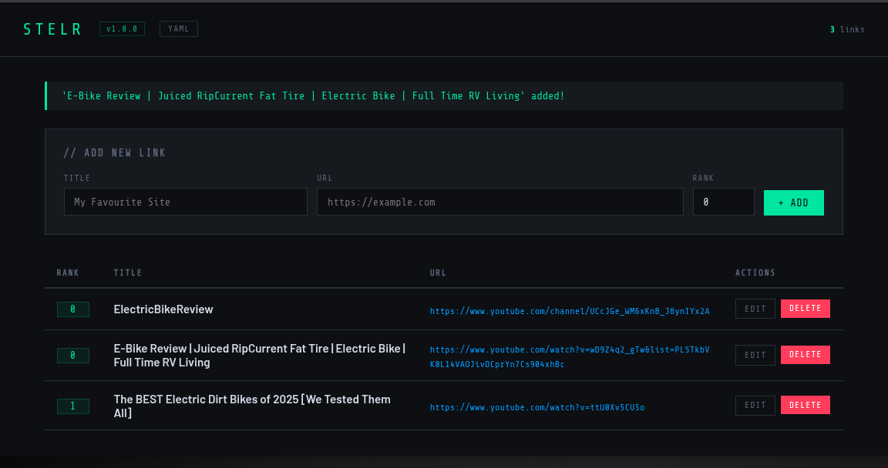
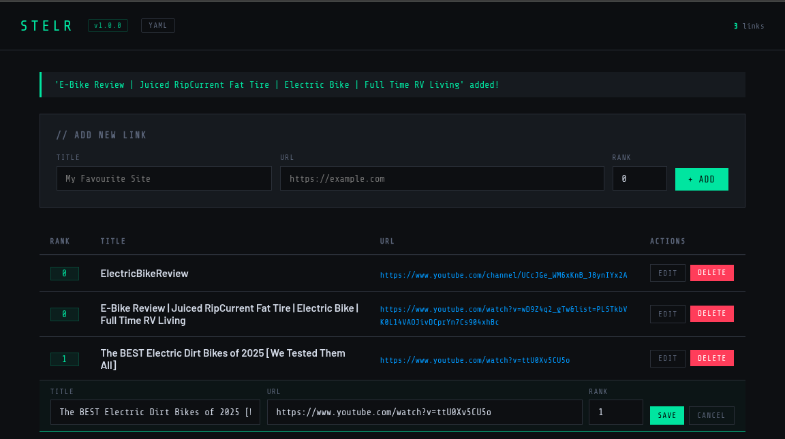

# 🔗 Stelr

**v6.1.0** · [AGPL-3.0](LICENSE)

Stelr is a web app for saving, organising, and ranking URLs. Add any link with a
title and a numeric rank — Stelr keeps them sorted and accessible from any browser.
User accounts are required to access the app, with admin-controlled registration
and approval.

---

## New features and bug fixes

- **Wallpapers** — each user can put a dimmed, optionally blurred photo from Pixabay behind their dashboard, chosen at random or from their own keywords (needs a Pixabay API key added by the admin)
- REST API endpoints for wallpapers: desktop clients can fetch and download the same wallpaper the dashboard shows, and admins can manage the Pixabay API key
- Third-party API keys are stored encrypted, using a key derived from `SECRET_KEY`
- **Desktop app now available for Windows, macOS, and Linux** — including a native Flatpak package on Linux, alongside the existing tarball/`make install` option
- Desktop app: added group support — organize bookmarks into folders and filter by group, matching the web UI
- Desktop app: the window title and a status label now show the app's version
- Desktop app (Linux): fixed the app icon not appearing in the dock, taskbar, or app switcher
- Browser extension: required opt-in warning before connecting to a plain-HTTP, non-localhost Stelr server, since credentials and the API token would otherwise cross the network unencrypted
- Fixed the browser extension failing to request server permissions on Firefox versions before 128
- Browser extension: clearer error messages when the server can't be reached, including guidance for Firefox's Local Network Access protection blocking self-hosted servers on a local network

## Features

- Save URLs with a title and rank
- Edit or delete any saved link
- Links are always displayed sorted by rank (lowest first)
- User accounts with login, session timeout, and logout
- Admin-controlled user registration and approval queue
- REST API for programmatic access
- Browser extension (Chrome, Edge, Firefox) to save pages or sync bookmarks, one-way or two-way
- Desktop app (Windows, macOS, Linux) for browsing and managing your links outside the browser
- Choice of storage backend — from simple files to full databases
- Data is persisted across restarts via Docker volumes
- Admin can change user passwords
- User can change their own password
- Filter entries by keyword (substring) in title or URL
- Filter entries by rank using a numerical comparison (<, <=, ==, >=, >)
- Group links into folders, and sort entries by clicking a column header
- Optional per-user wallpaper from Pixabay, dimmed so the dashboard stays readable

---

## To do

- User requests
  - Create store accounts for Chrome and Edge
  - Upload extensions to their respective stores

---

## Getting Started

Open **http://localhost:8082** in your browser. You will be presented with the
login page. On first run, an admin account is created automatically. If you
set `ADMIN_PASSWORD` (see [Configuration](#configuration)), that's the
password; otherwise a random one is generated and printed once to the
container logs (`podman compose logs`) — there's no fixed default, since a
well-known admin/admin credential is a real risk for a self-hosted,
internet-facing app. If you lose a generated password before copying it
down, the only recovery today is wiping the data volume and starting over
(see [Starting Stelr](#starting-stelr)).

---

## User Accounts

### Logging In
Enter your username and password on the login page. Sessions expire after a
configurable timeout (default 30 minutes) and you will be redirected to the
login page automatically.

### Registering
If registration is enabled by an admin, a **Register** link appears on the login
page. Fill in a username and password (minimum 6 characters) and submit. Your
account will be placed in a pending queue and cannot be used until an admin
approves it. If registration is disabled, the link is hidden and a message
instructs you to contact an administrator.

### Changing Your Password
Click the **Change Password** button in the header. Enter your current
password plus a new password (minimum 6 characters, entered twice to catch
typos). Your current password must be correct for the change to take effect.

### Logging Out
Click the **Logout** button in the top-right corner of any page.

---

## Using the App

Dashboard


### Adding a link
Fill in the **Title**, **URL**, and **Rank** fields at the top of the page and
click **Save**. Rank is a number — lower numbers appear first. You can use any
numbering scheme you like (1, 2, 3 or 10, 20, 30, etc.). Click **+ Add Another
Entry** before saving to queue up more rows and add several links at once —
empty extra rows are ignored, so you don't have to fill in every one you add.

Dashboard


### Editing a link
Click the **Edit** button on any row to expand an inline edit form. Change the
fields you want and click **Save**.



### Deleting a link
Click the **Delete** button on any row. You will be asked to confirm before the
link is removed.

### Filtering links
Use the **Filter Links** panel above the table to narrow down what's shown.
Enter a keyword to match against the title or URL (case-insensitive substring
match), and/or pick a rank comparison (`<`, `<=`, `==`, `>=`, `>`) with a value
to only show links whose rank satisfies it. A **Group** dropdown in the same
panel narrows the list to a single group or to ungrouped links. Filters can
be combined. Click **Clear** to reset.

### Sorting links
Click any of the **Rank**, **Title**, or **URL** column headers to sort the
table by that column. Clicking the same header again reverses the direction;
an arrow next to the header shows the current sort field and direction.

### Showing or hiding the URL column
Click **Hide URL** above the table to declutter the view — sorting and
filtering by URL still work while the column is hidden, they just don't need
it to be visible on screen. Your preference is remembered on that device. On
narrow/mobile screens the URL column is hidden by default.

### Organizing links into groups
Use the **Manage Groups** panel to create, rename, or delete groups (folders)
for your links. When adding or editing a link, pick a group from the
**Group** dropdown, or leave it as "No Group". Deleting a group does not
delete its links — they simply become ungrouped.

### Managing API tokens
Use the **API Tokens** panel to create personal access tokens for the [REST
API](#rest-api) and [CLI tool](#cli-tool) — useful for scripts, browser
extensions, or anything outside the browser session. Give the token a name
(e.g. `laptop-cli`) and click **+ Create Token**; the raw token is shown once
in a popup, so copy it immediately — Stelr only stores a hash of it and can't
show it again. Click **Revoke** on a token to invalidate it immediately.

### Setting a wallpaper
Click **Wallpaper** in the header to put a photo behind your dashboard. This
needs a Pixabay API key added by your admin (see [Wallpaper
Sources](#wallpaper-sources)); until then the option is greyed out.

- **Source** — where images come from. Pixabay is the only source today.
- **Image selection** — *Random* picks from Pixabay's editor's-choice
  nature, places, and background photos. *Keywords* takes a comma-separated
  list (e.g. `mountains, fog, ocean`) and uses one of them, chosen at random,
  for each new image.
- **Change image** — once a day (default), on every login, or only when you
  click **Next image**.
- **Dim** — how much the whole image is darkened (default 60%).
- **Panel opacity** — how much the panels hide the image (default 70%).
  Panels are frosted: the image shows through them, but it's blurred and
  darkened behind each panel, so text stays readable even with a bright
  image. At 100% the panels are solid.
- **Blur** — softens the image itself.

Changes preview live while the dialog is open. Collapsing the
[Groups and API Tokens](#organizing-links-into-groups) panels also shows
more of the image.

The photographer and a link to the image's Pixabay page are shown in the
bottom-right corner. Images are downloaded and served by Stelr itself, as
Pixabay's API terms require, so your browser never loads them from Pixabay.
Desktop apps can show the same wallpaper through the [wallpaper
API](#wallpaper).

---

## Admin Panel

The admin panel is accessible via the **Admin** button in the header, visible
only to admin accounts. It is available at **/admin**.

### Registration Toggle
Enable or disable the public registration page with a single button. When
disabled, the register link is hidden from the login page and new users can
only be created directly by an admin.

### Wallpaper Sources
Manages the API key that wallpapers need. One key serves every user on the
server; search results are cached for 24 hours, which keeps usage well within
Pixabay's rate limit of 100 requests per minute.

To enable Pixabay, create a free account, copy your key from
[pixabay.com/api/docs](https://pixabay.com/api/docs/), paste it into the
**API key** field, and click **Verify & Save**. How the key is protected:

- **At rest** — it's checked with Pixabay first, then encrypted (Fernet:
  AES-128 + HMAC-SHA256) with a key derived from `SECRET_KEY` before it's
  written to the storage backend. A copy of the database or data volume alone
  doesn't reveal it. The admin page only ever shows its last four characters.
- **In use** — it's only sent from the Stelr server to Pixabay, over HTTPS
  with certificate checks, and redirects are refused so it can't be bounced
  elsewhere. It's never sent to browsers or written to logs. (Pixabay only
  accepts the key in the request URL; TLS encrypts that in transit.)
- **When you enter it** — the form travels over whatever connection you use
  to reach Stelr. The admin page warns you if that's plain HTTP from another
  machine; use HTTPS (e.g. a reverse proxy) to keep the key off the network
  in the clear.

Saving a key requires `SECRET_KEY` to be set to a random value of at least 32
characters — the built-in default is public, so it can't protect anything. If
`SECRET_KEY` changes later, the stored key can't be decrypted any more; the
admin page says so, and you paste it in again.

Admins can also check, set, and remove the key through the [admin wallpaper
API](#admin-wallpaper-sources).

Alternatively, set `PIXABAY_API_KEY` in the server's environment. That
overrides the stored key and can't be changed from the admin page or API.

### Pending Approvals
When registration is enabled, new sign-ups appear here awaiting approval. Each
entry can be **Approved** (activating the account) or **Rejected** (deleting
the registration). A warning badge in the header shows the number of pending
requests.

### Create User
Admins can create accounts directly, bypassing the registration queue. A
username, password, and optional admin flag can be set. Accounts created this
way are active immediately.

### Active Users
Lists all approved accounts. Each row has a **Reset PW** button that opens a
dialog to set a new password for that user (minimum 6 characters, entered
twice to catch typos) — no knowledge of their current password is required.
Non-admin users can be deleted, which also removes all of their saved links.
Admin accounts cannot be deleted.

### All Links
A read-only view of every link saved by every user, showing the owning username,
title, URL, and rank.

---

## REST API

Stelr exposes a full JSON API for managing your own links, groups, and
tokens programmatically — the same API the CLI tool and web UI's own token
panel use. Two auth methods are supported:

- **API token** — an `Authorization: Bearer <token>` header. This is what
  scripts, the CLI, and future browser extensions should use. Create tokens
  from the [API Tokens panel](#managing-api-tokens) or via `POST /api/tokens`.
- **Session cookie** — the same cookie the web UI uses after `/login`. Handy
  for quick `curl` testing without generating a token.

| Endpoint                  | Method | Auth required | Description                                    |
|----------------------------|--------|----------------|-------------------------------------------------|
| `/login`                   | POST   | No             | Web UI login; sets the session cookie          |
| `/api/tokens`               | POST   | No\*           | Create a token (bootstrap with username/password, or mint one for the current session) |
| `/api/tokens`               | GET    | Yes            | List your tokens (id + name only)              |
| `/api/tokens/<id>`           | DELETE | Yes            | Revoke a token                                 |
| `/api/links`                | GET    | Yes            | List your links (supports the same `q`, `rank_op`, `rank_val`, `group`, `sort`, `dir` params as the web UI's filter/sort) |
| `/api/links`                | POST   | Yes            | Create a link                                  |
| `/api/links/<id>`           | GET    | Yes            | Get a single link                              |
| `/api/links/<id>`           | PUT    | Yes            | Update a link (partial — omitted fields are unchanged) |
| `/api/links/<id>`           | DELETE | Yes            | Delete a link                                  |
| `/api/groups`               | GET    | Yes            | List your groups                               |
| `/api/groups`               | POST   | Yes            | Create a group                                 |
| `/api/groups/<id>`           | PUT    | Yes            | Rename a group                                 |
| `/api/groups/<id>`           | DELETE | Yes            | Delete a group (its links become ungrouped)    |
| `/api/wallpaper`            | GET    | Yes            | Your wallpaper settings and current image, rotated if due (see below) |
| `/api/wallpaper/next`       | POST   | Yes            | Pick a new image now, like the web UI's **Next image** |
| `/api/wallpaper/image`      | GET    | Yes            | Download your current image                     |
| `/api/wallpaper/image/<id>` | GET    | Yes            | Download a specific cached image                |
| `/api/admin/wallpaper`      | GET    | Admin          | Wallpaper sources and whether each has an API key |
| `/api/admin/wallpaper/<provider>/key` | PUT | Admin  | Verify and store a provider's API key (encrypted) |
| `/api/admin/wallpaper/<provider>/key` | DELETE | Admin | Remove a provider's stored API key           |
| `/health`                   | GET    | No             | Returns app status, version, and active backend |

\* `POST /api/tokens` needs either a `username`/`password` in the body, or an
existing session cookie — see below.

### Getting a token

From a script or a fresh machine, exchange your username and password for a
token once:

```bash
curl -X POST http://localhost:8082/api/tokens \
  -H "Content-Type: application/json" \
  -d '{"username": "myuser", "password": "mypassword", "name": "my-script"}'
```

```json
{"id": "9c6d...", "name": "my-script", "token": "stelr_AbCd...xyz"}
```

The `token` value is only ever returned at creation time — store it
somewhere safe (an env var, a secrets manager, the CLI's local config).
Use it as a Bearer token on every subsequent request:

```bash
curl -H "Authorization: Bearer stelr_AbCd...xyz" http://localhost:8082/api/links
```

### Managing links

```bash
# Create
curl -X POST http://localhost:8082/api/links \
  -H "Authorization: Bearer $TOKEN" -H "Content-Type: application/json" \
  -d '{"title": "GitHub", "url": "https://github.com", "rank": 1}'

# List (with the web UI's filter/sort params)
curl -H "Authorization: Bearer $TOKEN" "http://localhost:8082/api/links?q=github&sort=title"

# Update just the rank
curl -X PUT http://localhost:8082/api/links/<id> \
  -H "Authorization: Bearer $TOKEN" -H "Content-Type: application/json" \
  -d '{"rank": 5}'

# Delete
curl -X DELETE http://localhost:8082/api/links/<id> -H "Authorization: Bearer $TOKEN"
```

A link looks like:

```json
{
  "id": "b6b9c2b0-3f1a-4e2c-9a1d-8f3e2c1d0a9b",
  "user_id": "1a2b3c4d-5e6f-4a1b-9c2d-3e4f5a6b7c8d",
  "title": "GitHub",
  "url": "https://github.com",
  "rank": 1,
  "group_id": ""
}
```

`group_id` is an empty string when a link isn't assigned to a group.

### Managing groups

```bash
curl -X POST http://localhost:8082/api/groups \
  -H "Authorization: Bearer $TOKEN" -H "Content-Type: application/json" \
  -d '{"name": "Work"}'
```

### Wallpaper

These let a desktop app show the same wallpaper as the web dashboard: the
same settings, the same rotation, and the same image file. Settings are
changed from the web UI's **Wallpaper** dialog.

```bash
# Settings + current image. Rotates first if due, exactly like loading the
# dashboard. Pass session_start=1 on the first call after the app starts, so
# "Every login" rotation means "every app launch".
curl -H "Authorization: Bearer $TOKEN" "http://localhost:8082/api/wallpaper?session_start=1"
```

```json
{
  "enabled": true,
  "provider": "pixabay",
  "mode": "keywords",
  "keywords": ["mountains", "fog"],
  "rotation": "daily",
  "dim": 60,
  "blur": true,
  "panel_opacity": 70,
  "image": {
    "id": 1867616,
    "download_url": "/api/wallpaper/image/1867616",
    "content_type": "image/jpeg",
    "date": "2026-11-22",
    "user": "someone",
    "page": "https://pixabay.com/photos/...",
    "provider": "Pixabay",
    "credit": "Photo by someone on Pixabay"
  },
  "error": null
}
```

```bash
# Download it (send If-None-Match with the last ETag to get a 304 instead)
curl -H "Authorization: Bearer $TOKEN" -o wallpaper.jpg \
  "http://localhost:8082/api/wallpaper/image/1867616"

# Ask for a different image
curl -X POST -H "Authorization: Bearer $TOKEN" http://localhost:8082/api/wallpaper/next
```

To match the web UI, draw the image to cover the window, blur it by about 6px
if `blur` is true, lay the background colour `#0d0f12` over it at `dim`
percent opacity, and show `credit` linked to `page`. Draw panels in
`#161a1f` at `panel_opacity` percent, over a blurred (~14px) and darkened
(~55% brightness) copy of what's behind them.

- `image` is `null` when wallpaper is off, or no image could be fetched yet.
- `error` explains a problem, such as a missing API key or Pixabay being
  unreachable. When there is one, `image` is still the last good image if
  one is cached, so a client can keep showing it.
- Image ids never change content, so clients can cache downloads by id.
- `POST /api/wallpaper/next` returns `409` when wallpaper is turned off.

### Admin: wallpaper sources

The API version of the Admin page's [Wallpaper Sources](#wallpaper-sources)
section. These need a token (or session) belonging to an **admin** account;
anyone else gets `403`. The admin flag is checked on every request, so a
demoted admin's existing tokens stop working here straight away. `<provider>`
is `pixabay` today.

```bash
# Status — the key itself is never returned, only its last 4 characters
curl -H "Authorization: Bearer $ADMIN_TOKEN" http://localhost:8082/api/admin/wallpaper
```

```json
{
  "providers": [{
    "id": "pixabay", "name": "Pixabay", "url": "https://pixabay.com/", "configured": true,
    "key": {"source": "db", "hint": "…789a", "error": null, "editable": true}
  }],
  "secret_key_strong": true
}
```

`key.source` is `"db"` (stored from the Admin page or API), `"env"` (set with
`PIXABAY_API_KEY`, so not editable), or `null`. `key.error` is set when a
stored key can't be decrypted because `SECRET_KEY` changed.

```bash
# Set or replace the key. It's checked with Pixabay first, then encrypted.
curl -X PUT -H "Authorization: Bearer $ADMIN_TOKEN" -H "Content-Type: application/json" \
  -d '{"api_key": "12345678-0123456789abcdef0123456789a"}' \
  https://stelr.example.com/api/admin/wallpaper/pixabay/key

# Remove it
curl -X DELETE -H "Authorization: Bearer $ADMIN_TOKEN" \
  https://stelr.example.com/api/admin/wallpaper/pixabay/key
```

Both return the same status object as `GET`. `PUT` fails with `400` if
Pixabay rejects the key or it's malformed, and `409` if `SECRET_KEY` is too
weak to protect it or the key is set with `PIXABAY_API_KEY`. Send the key
over HTTPS: if a `PUT` arrives over plain HTTP from another machine, it still
succeeds but the response includes a `warning`, and clients should tell the
user, since the key crossed the network unencrypted.

### Health check

No authentication required — useful for uptime checks and container
healthchecks.

```bash
curl http://localhost:8082/health
```

```json
{"status": "ok", "version": "<version>", "backend": "xml"}
```

---

## CLI Tool

`cli/stelr_cli.py` is a standalone command-line client for the REST API —
useful for scripting, bulk imports, or managing your links without opening a
browser.

```bash
cd cli
pip install -r requirements.txt

python3 stelr_cli.py login http://localhost:8082    # prompts for username/password
python3 stelr_cli.py whoami

python3 stelr_cli.py add "GitHub" "https://github.com" --rank 1 --group Work
python3 stelr_cli.py list
python3 stelr_cli.py list --filter github --sort title
python3 stelr_cli.py update <id> --rank 5
python3 stelr_cli.py delete <id>

python3 stelr_cli.py groups
python3 stelr_cli.py group-create Work
python3 stelr_cli.py group-delete Work

python3 stelr_cli.py tokens
python3 stelr_cli.py logout
```

`login` stores the issued token in `~/.stelr/config.json` (mode `0600`); every
other command reads it from there. `logout` revokes that token on the server
and clears the local file. Add `-y`/`--yes` to `delete`/`group-delete` to
skip the confirmation prompt in scripts.

---

## Browser Extension

`browser-extension/` is a Manifest V3 extension for Chrome, Edge, and Firefox
that connects to your Stelr instance via an API token. It supports three
modes: save the current page on demand, sync a specific bookmark folder, or
sync your entire bookmark tree — each on a manual or scheduled basis.
Two-way sync (pulling Stelr-only links into the browser) and deletion
propagation (keeping deletes in sync on both sides) are both opt-in. See
[`browser-extension/README.md`](browser-extension/README.md) for setup and
full details.

- **Firefox**: [available on addons.mozilla.org](https://addons.mozilla.org/en-US/firefox/addon/stelr-bookmark-sync/)
- **Chrome / Edge**: not yet published — load unpacked or build with
  `package.py` per the instructions above

---

## Desktop App

`stelr-desktop/` is a native desktop client built with [Fyne](https://fyne.io)
that connects to your Stelr instance via the same REST API as the CLI and
browser extension. Log in with your username and password, then search,
add, edit, delete, and open your saved links — with group support matching
the web UI.

Available on **Windows**, **macOS** (Intel and Apple Silicon), and **Linux**
(x86_64 and arm64) — Linux users can install a downloaded tarball with the
bundled `Makefile`, or via a native **Flatpak** package. See
[`stelr-desktop/README.md`](stelr-desktop/README.md) for build and usage
instructions.

---

## Storage Backends

Stelr supports five storage backends, selected at startup via the
`STORAGE_BACKEND` environment variable. On first run, each backend will
automatically create any required directory, file, or database — no manual
setup is needed.

### XML (default)
Links and users are stored in a plain XML file.

```
STORAGE_BACKEND=xml
```

Data file location is controlled by `XML_FILE` (default: `/data/links.xml`).

---

### YAML
Links and users are stored in a YAML file — human-readable and easy to inspect.

```
STORAGE_BACKEND=yaml
```

Data file location is controlled by `YAML_FILE` (default: `/data/links.yaml`).

---

### HTML
Links and users are stored in a structured HTML file. User data is embedded as
JSON in a `<script>` tag; links are stored as a `<ul>` list.

```
STORAGE_BACKEND=html
```

Data file location is controlled by `HTML_FILE` (default: `/data/links.html`).

---

### MySQL
Links and users are stored in a MySQL database. Stelr will create the database
and tables automatically on first run.

```
STORAGE_BACKEND=mysql
```

| Variable         | Default | Description   |
|------------------|---------|---------------|
| `MYSQL_HOST`     | `mysql` | Hostname      |
| `MYSQL_PORT`     | `3306`  | Port          |
| `MYSQL_USER`     | `stelr` | Username      |
| `MYSQL_PASSWORD` | `stelr` | Password      |
| `MYSQL_DATABASE` | `stelr` | Database name |
| `MYSQL_POOL_SIZE` | `10` | Max pooled connections |

`MYSQL_FLUSH_LOG_AT_TRX_COMMIT` (default `1`, set on the `mysql` container, not the app) controls
InnoDB's write durability vs. speed. `1` fsyncs on every commit and survives any crash, but is the
slowest. `2` only fsyncs once/sec — writes are much faster, but up to ~1 second of the most recent
adds/deletes can be lost if the *host* (not just MySQL) crashes or loses power. `0` is faster still
but can also lose data on a plain MySQL crash. Example:

```bash
MYSQL_FLUSH_LOG_AT_TRX_COMMIT=2 podman compose --profile mysql up
```

---

### PostgreSQL
Links and users are stored in a PostgreSQL database. Stelr will create the
database and tables automatically on first run.

```
STORAGE_BACKEND=postgresql
```

| Variable            | Default    | Description   |
|---------------------|------------|---------------|
| `POSTGRES_HOST`     | `postgres` | Hostname      |
| `POSTGRES_PORT`     | `5432`     | Port          |
| `POSTGRES_USER`     | `stelr`    | Username      |
| `POSTGRES_PASSWORD` | `stelr`    | Password      |
| `POSTGRES_DB`       | `stelr`    | Database name |
| `POSTGRES_POOL_SIZE`| `10`       | Max pooled connections |

---

## Configuration

| Environment Variable      | Default                  | Description                              |
|---------------------------|--------------------------|------------------------------------------|
| `STORAGE_BACKEND`         | `xml`                    | Storage plugin to use                    |
| `ADMIN_USERNAME`          | `admin`                  | Username for the auto-created admin      |
| `ADMIN_PASSWORD`          | *(random, generated)*    | Password for the auto-created admin — set this to skip generation and use your own |
| `SECRET_KEY`              | *(default set)*          | Flask session secret, also used to encrypt stored API keys — set a random value of 32+ characters in production |
| `SESSION_TIMEOUT_MINUTES` | `30`                     | Session inactivity timeout in minutes    |
| `PIXABAY_API_KEY`         | *(unset)*                | Optional — overrides the Pixabay key stored from the Admin page; see [Wallpaper Sources](#wallpaper-sources) |
| `WALLPAPER_CACHE_DIR`     | `/data/wallpaper-cache`  | Where downloaded wallpapers and cached searches are kept (falls back to a temp dir if not writable) |

---

## Starting Stelr

Use the `--profile` flag to select a backend. The app is available at
**http://localhost:8082**.

```bash
# XML (default)
podman compose up

# YAML
podman compose --profile yaml up

# HTML
podman compose --profile html up

# MySQL
podman compose --profile mysql up

# PostgreSQL
podman compose --profile postgresql up
```

To run in the background, add `-d`:

```bash
podman compose --profile yaml up -d
```

To stop without remo1ving data:

```bash
podman compose --profile yaml stop
```

To stop and remove all data volumes (fresh start):

```bash
podman compose --profile yaml down -v
```

### Changing the admin password or session timeout

```bash
ADMIN_PASSWORD=mysecurepassword SESSION_TIMEOUT_MINUTES=60 podman compose up
```

### Keeping settings in a `.env` file

Instead of typing variables on every start, put them in a `.env` file next to
`docker-compose.yml`; `podman compose` and `docker compose` read it
automatically. At a minimum, set your own `SECRET_KEY`: the built-in default
is public, so anyone could forge a login session with it, and Stelr won't
store API keys (such as the wallpaper key) until it's changed.

```bash
# Generate a strong SECRET_KEY
python3 -c "import secrets; print(secrets.token_urlsafe(48))"
```

```ini
# .env
SECRET_KEY=paste-the-generated-value-here
ADMIN_PASSWORD=mysecurepassword
```

Keep `.env` out of version control, and keep `SECRET_KEY` the same across
restarts and upgrades. Changing it logs everyone out and makes stored API
keys unreadable until an admin enters them again.

---

## License

Stelr is licensed under the [GNU Affero General Public License v3.0](LICENSE)
(AGPL-3.0). If you run a modified version of Stelr as a network service,
the AGPL requires that you make your modified source available to that
service's users.
